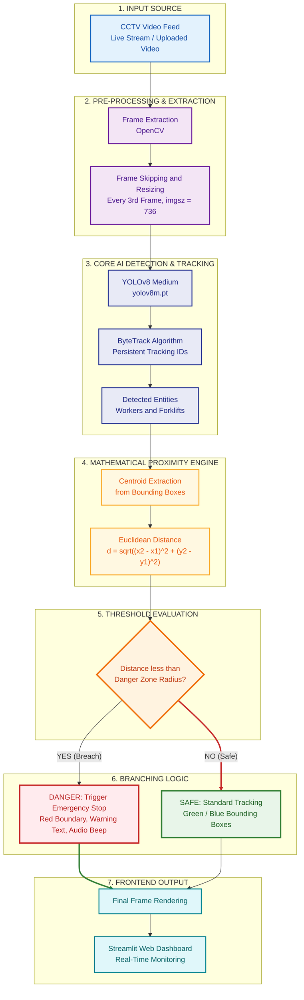

# RoboSight Guard: AI-Powered Workplace Safety & Collision Avoidance System


## Abstract

RoboSight Guard is a highly optimized, computer vision-based safety system engineered to mitigate the risk of industrial accidents. By ingesting and processing real-time CCTV footage, the system identifies human workers and heavy industrial machinery (specifically forklifts), continuously calculates their spatial Euclidean proximity, and triggers immediate visual and auditory emergency protocols if a predefined safety radius is breached. Developed as a robust solution for the NYLP AI Hackathon 2026, the architecture emphasizes practical deployment, low-latency inference, and real-time hazard mitigation in dynamic environments.

## Problem Statement

Industrial warehouses and construction sites exhibit a high statistical probability of collisions between pedestrians and moving machinery. Conventional CCTV networks serve a purely passive role, heavily reliant on continuous human observation which is prone to fatigue and error. The objective of this research and development phase was to engineer an active, automated AI surveillance layer capable of proactively detecting near-miss events and impending collisions under suboptimal conditions, including camera glare, motion blur, and low-resolution sensor feeds.

## Research & Methodology (System Evolution)

### Phase 1: Custom Model Training & Weights Generation

Initial developmental phases focused on training a specialized YOLOv8 architecture strictly for forklift detection. The model was trained using a custom annotated dataset (`data.yaml`) over 10 epochs to generate the baseline weights.

*Training Configurations and Checkpoint Verification:*

<!-- Yahan apne step4_train.py aur runs/detect folder ke screenshots upload karke  tags add karein -->

### Phase 2: Addressing the Domain Gap & Tracking Integration

While the custom model demonstrated high precision on the localized dataset, deployment against raw CCTV feeds revealed a significant "Domain Gap" caused by environmental variance. The architecture was strategically pivoted:

- **Generalized Weights:** Transitioned to a generalized, pre-trained medium architecture (`yolov8m.pt`) for superior feature extraction.
- **ByteTrack Algorithm:** To counter false negatives caused by harsh lighting and partial occlusions, the YOLO ByteTrack algorithm was integrated. This assigned persistent tracking IDs, stabilizing bounding box rendering across consecutive frames.
- **Algorithmic Filtering:** Replaced rigid class dependencies with a dimensional filtering heuristic to identify moving industrial objects while suppressing background noise.

### Phase 3: Web Dashboard Optimization

The backend computer vision pipeline was bridged to a Streamlit frontend for user interaction. To prevent browser rendering latency during high-resolution processing:

- **Resolution Scaling:** Inference resolution was constrained to `imgsz=736`.
- **Temporal Subsampling:** A frame-skipping mechanism was introduced, processing every third frame to maintain real-time performance overhead without sacrificing safety parameters.

## System Architecture Workflow

### Visual Pipeline (Flowchart)



### Text Workflow

```text
[CCTV Video Input Stream]
           |
           v
[Frame Extraction & Pre-processing]
           |
           v
[YOLOv8 Medium + ByteTrack Algorithm]
(Continuous Entity Identification)
           |
           v
[Euclidean Distance Calculation]
(Formula: sqrt((x2 - x1)^2 + (y2 - y1)^2))
           |
           v
[Proximity Threshold Evaluation]
(Is derived distance < Danger Zone Radius?)
           |
           +-----------------------+
           |                       |
         [YES]                    [NO]
           |                       |
[Trigger Emergency Stop]  [Maintain Standard Tracking]
(Red Visual Border,       (Render Green/Blue Bounding Boxes)
 Alert Text, Audio Beep)           |
           |                       |
           +-----------------------+
           |
           v
[Frontend Rendering via Streamlit Interface]
```

## Key Features

- **Dual Entity Classification:** Accurately isolates human workers from industrial vehicles within the same temporal frame.
- **Dynamic Spatial Tracking:** Real-time geometric distance tracking between the centroid coordinates of active bounding boxes.
- **Customizable Parameter Controls:** Adjustable threshold for the Danger Zone Radius via the frontend web dashboard.
- **Immediate Hazard Alerting:** Instantaneous visual feedback (thick boundary lines, warning overlays) and auditory alerts upon perimeter breach.
- **Optimized Interactive Dashboard:** A user-friendly Streamlit web interface permitting seamless video uploads and real-time inference monitoring.

## Technology Stack

- **Programming Language:** Python 3.13
- **Computer Vision Framework:** OpenCV
- **Deep Learning Architecture:** PyTorch, YOLOv8 (Ultralytics)
- **Object Tracking:** ByteTrack
- **Frontend Development:** Streamlit
- **Mathematical Operations:** Python Standard Math Library

## Project Structure

```text
RoboSight_Guard/
├── Video/                # Directory containing test CCTV footage
├── dataset/              # Custom dataset and configurations
│   └── data.yaml         # YOLO dataset configuration file
├── runs/                 # YOLOv8 training outputs, graphs, and weights
├── step2_tracking.py     # Initial script for base YOLOv8 object tracking
├── step3_math.py         # Core backend logic for distance and alert triggers
├── step4_train.py        # Script utilized for custom model training phase
├── step5_dashboard.py    # Final Streamlit web application integration
├── yolov8m.pt            # Pre-trained YOLOv8 Medium model weights
└── .gitignore            # Repository exclusion parameters
```

## Challenges and Limitations

- **Hardware Dependency:** The system currently relies on local CPU/GPU processing. Inference speeds are bound by the hardware limitations of the host machine, particularly during real-time 1080p stream analysis.
- **2D Plane Assumption:** Euclidean distance is calculated on a 2D camera plane. Extreme perspective distortion or severely angled cameras may result in skewed distance metrics (e.g., objects appearing closer vertically than they are physically).
- **Severe Occlusion:** If a worker is entirely obscured behind heavy machinery or stacked pallets for extended frames, the tracker may momentarily lose the entity ID until they re-enter the field of view.

## Future Implementations

- **Edge Device Deployment:** Migrating the inference engine to edge computing hardware such as NVIDIA Jetson Nano for localized, low-latency processing without relying on a central server.
- **3D Depth Estimation:** Integrating stereo-vision or depth-mapping models to calculate real-world 3D distance rather than 2D pixel-based distance, significantly improving collision accuracy.
- **Cloud Logging and Analytics:** Automating the capture of near-miss events and logging timestamps, incident snapshots, and frequency metrics to a cloud database (e.g., Firebase or AWS) for managerial safety audits.
- **Multi-Camera Aggregation:** Stitching feeds from multiple warehouse cameras to maintain a singular tracking ID for a worker moving across different zones.

## System Outputs & Visual Documentation

### Standard Tracking (Safe Zone)

Base identification and tracking logic without proximity breach (Reference: `step2_tracking.py`).


### Emergency Alert Triggered (Danger Zone)

Euclidean threshold breach resulting in visual collision warnings (Reference: `step3_math.py`).


### Web Dashboard Interface

The final production-ready frontend control panel featuring frame-skipping optimizations (Reference: `step5_dashboard.py`).


---

Developed by **Ali Asjad**
Computer Vision Engineer | BS Artificial Intelligence
